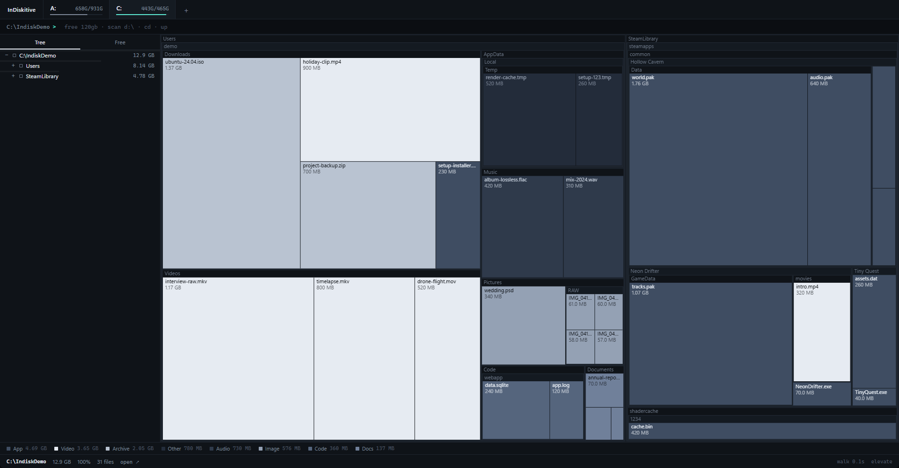
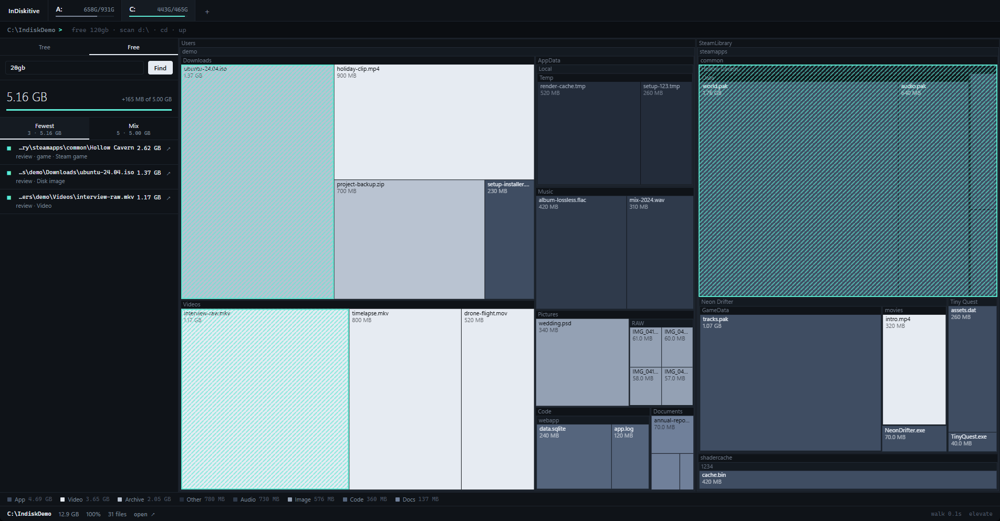

<h1 align="center">InDiskitive</h1>

<p align="center">
  See where your disk space went. A fast, quiet treemap disk usage viewer for Windows.
</p>

<p align="center">
  <a href="https://github.com/lucasfrans/InDiskitive/releases/latest"></a>
  
  <a href="LICENSE"></a>
</p>

<p align="center">
  
</p>

## Download

Download **[InDiskitive.exe](https://github.com/lucasfrans/InDiskitive/raw/refs/heads/main/InDiskitive.exe)** straight from this repo, or grab it from the **[Releases page](https://github.com/lucasfrans/InDiskitive/releases/latest)**. It is a single portable file, with no installer.

Windows may show a SmartScreen warning because the file is not code-signed. Choose **More info, then Run anyway**. It requires the Microsoft Edge WebView2 runtime, which is already included in Windows 11 and up-to-date Windows 10.

## What it does

- **Treemap of your whole drive.** Every folder and file is drawn to scale, coloured by file type.
- **Fast.** A multithreaded Rust scanner walks a drive in seconds. Run it as administrator and it reads the NTFS Master File Table directly, which is much faster still.
- **Instant switching.** Finished scans are kept in memory, so clicking between drives doesn't rescan. Use the `↻` next to a drive to refresh it.
- **Free N GB.** Type `free 120gb` and get a few short lists of what to clear: the fewest items that cover the amount, safe-to-delete caches, whole game folders, and more.
- **Whole units, not fragments.** Game installs and folders are suggested as a whole, never as half-deleted pieces.
- **Read-only.** InDiskitive never deletes anything. It has no network access, no account and no telemetry.

<p align="center">
  
</p>

## Command line

Press <kbd>/</kbd> to focus the command line at the top.

| Command | Does |
| --- | --- |
| `free 120gb` | Find the best things to clear to free that much (also just `120gb`) |
| `scan d:\` | Scan a drive or folder (uses the cache if already scanned) |
| `refresh` | Rescan what you're looking at |
| `cd name` | Zoom into a folder (prefix match works) |
| `up` | Go up a level |
| `drives` | Back to the volume list |

Other controls: click a block to select it, double-click to zoom in, right-click or <kbd>Backspace</kbd> to go up, <kbd>Esc</kbd> to cancel a scan.

## Admin mode

Without administrator rights InDiskitive walks the directory tree, which is already quick. With admin rights, on an NTFS drive, it reads the file table straight from the volume. The first-run screen asks once, and there is a small `elevate` link in the status bar. If the fast path fails for any reason it falls back to the normal scan automatically.

## Build from source

You need [Node.js](https://nodejs.org), [Rust](https://rustup.rs) (MSVC toolchain) and the Visual Studio C++ Build Tools.

```powershell
git clone https://github.com/lucasfrans/InDiskitive.git
cd InDiskitive
npm install
npm run tauri dev            # run with hot reload
npm run tauri build -- --no-bundle   # release exe in src-tauri/target/release
```

If the linker fails with a very long project path, point Cargo at a short folder: `$env:CARGO_TARGET_DIR = "C:\t\indiskitive"`.

## How it works

| Part | Where |
| --- | --- |
| Directory walker and result pruning (Rust, rayon) | [`src-tauri/src/lib.rs`](src-tauri/src/lib.rs) |
| NTFS MFT reader | [`src-tauri/src/mft.rs`](src-tauri/src/mft.rs) |
| Treemap (canvas, squarified layout) | [`src/components/Treemap.tsx`](src/components/Treemap.tsx) |
| "Free N GB" planner | [`src/planner.ts`](src/planner.ts) |
| Microsoft Store packaging | [`store/`](store) |

Built with [Tauri 2](https://tauri.app), Rust, React and TypeScript.

## License

[MIT](LICENSE) © 2026 Lucas Fransen
